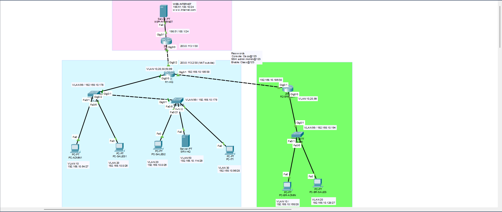

# TechNova GmbH – Firmennetzwerk (Cisco Packet Tracer)

Ich habe ein Netzwerk für eine kleine Firma geplant und in Cisco Packet Tracer aufgebaut.
Die Firma hat einen Hauptsitz, eine Filiale und Internetzugang.

## Themen
VLSM · VLANs · Trunking · Inter-VLAN-Routing · OSPF · DHCP + Relay · DNS · NAT/PAT · ACLs · SSH · Port Security · IPv6

## Netzwerke
| Netzwerk | VLAN | Subnetz |
|---|---|---|
| Hauptsitz Admin | 10 | 192.168.10.64/27 |
| Hauptsitz Vertrieb | 20 | 192.168.10.0/26 |
| Hauptsitz IT | 30 | 192.168.10.96/28 |
| Server | 50 | 192.168.10.112/29 |
| Filiale Admin | 10 | 192.168.10.160/28 |
| Filiale Vertrieb | 20 | 192.168.10.128/27 |
| Management | 99 | 192.168.10.176/29 |

## Tests
| Test | Ergebnis |
|---|---|
| Alle PCs bekommen eine IP per DHCP | ✅ |
| Hauptsitz und Filiale können sich erreichen | ✅ |
| Internetzugang über NAT | ✅ |
| Vertrieb kann das IT-Netz nicht erreichen (ACL) | ✅ |
| SSH nur aus dem IT-Netz möglich | ✅ |

## Ordner
- `topology/` – Packet-Tracer-Datei
- `configs/` – Konfigurationen der Router und Switches
- `verification/` – Ausgaben der show-Befehle
- `screenshots/` – Bilder von den Tests

## Zugangsdaten (nur für das Labor)
Console: `Cisco@123` · SSH: `admin / Admin@123` · Enable: `Class@123`

## Autor
**Yassine Elatiq**